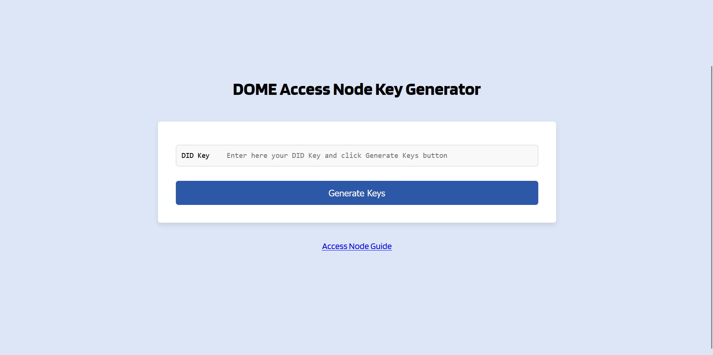
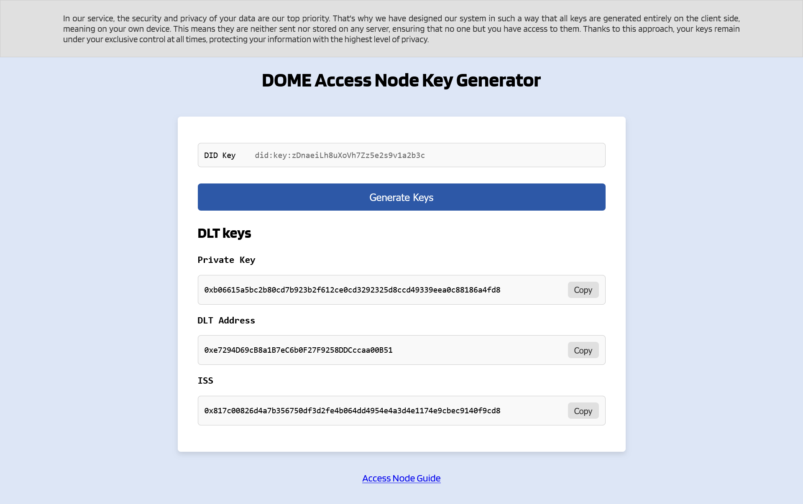

# Desmos and DLT onboarding

Desmos is the data replication service of a DOME Access Node. It synchronizes NGSI-LD entities with the other nodes, using the DLT (Alastria, through the `dlt-adapter-alastria` service) for secure, auditable transactions, and stores the data in the Scorpio Context Broker.

Before your node can replicate data, your organization needs credentials and keys, and must be registered in the DOME Trust Framework. This guide covers those steps and the related configuration files; installing and running the stack is covered in the [README](README.md).

**Key capabilities:**

- Data replication across DOME Access Nodes
- Integration with the Scorpio Context Broker (NGSI-LD)
- Secure, verifiable transactions via DLT

---

## Table of Contents

- [Prerequisites](#prerequisites)
- [Configuration Steps](#configuration-steps)
    - [Step 1: Obtain LEARCredentialMachine](#step-1-obtain-learcredentialmachine)
    - [Step 2: Generate DLT Keys](#step-2-generate-dlt-keys)
    - [Step 3: Register with DOME Trust Framework](#step-3-register-with-dome-trust-framework)
    - [Step 4: Configure Desmos](#step-4-configure-desmos)
    - [Step 5: Configure Secrets](#step-5-configure-secrets)
- [Deployment](#deployment)
- [Verification](#verification)
- [Troubleshooting](#troubleshooting)
- [Related Documentation](#related-documentation)

---

## Prerequisites

Before configuring Desmos, ensure you have:

- ✅ The stack installed up to step 2 of the wizard (see the [README](README.md)): the configuration files mentioned below exist in the installation directory
- ✅ A **LEARCredentialMachine** issued by your Legal Entity Appointed Representative (LEAR) in your **DOME Wallet**
- ✅ A **public domain name** pointing to the server, configured in the `Caddyfile`: Caddy obtains the TLS certificate automatically

---

## Configuration Steps

### Step 1: Obtain LEARCredentialMachine

Request a **LEARCredentialMachine** from your organization's Legal Entity Appointed Representative (LEAR). This credential:

- Contains your organization's DID (Decentralized Identifier)
- Includes the private key for authentication

---

### Step 2: Generate DLT Keys

Use the [DOME Access Node Key Generator](https://dome-marketplace.github.io/dome-crypto-generator/) to generate your DLT address and the other cryptographic keys.

1. Open the DOME Access Node Key Generator
2. Enter your DID key from the LEARCredentialMachine
3. Generate and securely store the following:
    - **DLT Private Key**
    - **DLT Address**
    - **DLT ISS**

The DLT private key and ISS go into `.env.dlt-adapter-alastria` (the comments in the file say which value goes where); the DLT address identifies your organization in the Trust Framework (Step 3). Don't use the DLT address as `DOME_EVENTS_CONTRACT_ADDRESS`: that is the shared DOME events contract, already set in the file.

**Screenshots:**





> [!CAUTION]
> **CRITICAL: Secure Key Storage**
> Your private keys **cannot be recovered** if lost. Store them securely using:
>
> - Hardware security modules (HSM)
> - Secure password managers (e.g., 1Password, Bitwarden)
> - Dedicated secrets vaults (e.g., HashiCorp Vault, AWS Secrets Manager)
>
> **Never:**
>
> - Commit keys to version control
> - Share keys via email or chat
> - Store them in plain text files on shared systems

---

### Step 3: Register with DOME Trust Framework

Register your organization and service with the DOME Trust Framework for your target environment. Lists exist for the sbx, dev and prd environments.

#### 3.1. Register as a Trusted Access Node

Add your organization to the **Trusted Access Node List** following the DOME Trust Framework instructions.

| **Links**                                                                                               |
|---------------------------------------------------------------------------------------------------------|
| [SBX](https://github.com/DOME-Marketplace/trust-framework/blob/main/sbx/trusted_access_nodes_list.yaml) |
| [DEV](https://github.com/DOME-Marketplace/trust-framework/blob/main/dev/trusted_access_nodes_list.yaml) |
| [PRD](https://github.com/DOME-Marketplace/trust-framework/blob/main/prd/trusted_access_nodes_list.yaml) |

**YAML Template:**

```yaml
# Add to the Trusted Access Node List
- name: <organization_name>
  dlt_address: <dlt_address>
```

**Placeholder values:**

- `<organization_name>`: Your legal organization name
- `<dlt_address>`: DLT address from Step 2

**Example:**

```yaml
- name: "Acme Corporation"
  dlt_address: "0x1234567890abcdef1234567890abcdef12345678"
```

#### 3.2. Register as a Trusted Service

Add your Desmos service to the **Trusted Services List** following the DOME Trust Framework instructions.

| **Links**                                                                                           |
|-----------------------------------------------------------------------------------------------------|
| [SBX](https://github.com/DOME-Marketplace/trust-framework/blob/main/sbx/trusted_services_list.yaml) |
| [DEV](https://github.com/DOME-Marketplace/trust-framework/blob/main/dev/trusted_services_list.yaml) |
| [PRD](https://github.com/DOME-Marketplace/trust-framework/blob/main/prd/trusted_services_list.yaml) |

**YAML Template:**

```yaml
# Add to the Trusted Services List
- clientId: "<did:key>"
  redirectUris: [ ]
  scopes: [ ]
  clientAuthenticationMethods: [ "client_secret_jwt" ]
  authorizationGrantTypes: [ "client_credentials" ]
  postLogoutRedirectUris: [ ]
  requireAuthorizationConsent: false
  requireProofKey: false
  jwkSetUrl: "https://verifier.dome-marketplace-<env>.org/oidc/did/<did:key>"
  tokenEndpointAuthenticationSigningAlgorithm: "ES256"
```

> [!NOTE]
> Replace `<did:key>` with the DID key of your LEARCredentialMachine.
> Replace `<env>` with the environment.

---

### Step 4: Configure Desmos

Edit `.env.desmos` in the installation directory (wizard step 2 creates it from `.env.desmos.example`).

#### Required Configuration Variables

| Variable                           | Description                                        | Example Value                          |
|------------------------------------|----------------------------------------------------|----------------------------------------|
| `SPRING_PROFILES_ACTIVE`           | Desmos profile (see mapping below)                 | `dev`                                  |
| `OPERATOR_ORGANIZATION_IDENTIFIER` | Your organization's DID from LEARCredentialMachine | `did:key:zDnaei...`                    |
| `API_EXTERNAL_DOMAIN`              | Public URL of Desmos, as published by Caddy        | `https://node.example.org/desmos`      |

`API_EXTERNAL_DOMAIN` is the address other nodes use to reach your Desmos. In this stack Desmos is published by Caddy under the `/desmos` path of your domain, so the value is `https://<your-domain>/desmos`, **without a trailing slash**: Desmos appends its own paths to it, and the address also ends up in the DLT transactions, where it can't be corrected afterwards.

#### Environment Profile Mapping

Choose the Desmos profile matching the `DOME_ENVIRONMENT` set in `.env.runtime`:

| Desmos Profile (`SPRING_PROFILES_ACTIVE`) | DOME Environment (GitOps) | Description                                 |
|:-----------------------------------------:|:-------------------------:|---------------------------------------------|
|                   `dev`                   |     **sbx** (Sandbox)     | Development/integration testing environment |
|                  `test`                   |   **dev** (Development)   | QA environment                              |
|                  `prod`                   |   **prd** (Production)    | Production environment                      |

The profile also selects the DOME node Desmos synchronizes with at startup and the trusted lists it loads.

#### Configuration Examples

**Sandbox:**

```properties
# Desmos profile for the sandbox environment
SPRING_PROFILES_ACTIVE=dev
# Organization DID from LEARCredentialMachine
OPERATOR_ORGANIZATION_IDENTIFIER=did:key:zDnaeiLh8uXoVh7Zz5e2s9v1a2b3c
# Public URL of Desmos (your domain + /desmos, no trailing slash)
API_EXTERNAL_DOMAIN=https://node-sandbox.example.org/desmos
```

**Production:**

```properties
# Desmos profile for the production environment
SPRING_PROFILES_ACTIVE=prod
# Organization DID from LEARCredentialMachine
OPERATOR_ORGANIZATION_IDENTIFIER=did:key:zDnaeiLh8uXoVh7Zz5e2s9v1a2b3c
# Public URL of Desmos (your domain + /desmos, no trailing slash)
API_EXTERNAL_DOMAIN=https://node.example.org/desmos
```

> The database, broker and DLT adapter connections of Desmos are preconfigured in the stack definition: you don't need to set them.

---

### Step 5: Configure Secrets

Edit `.secrets.desmos` (created by wizard step 2 from `.secrets.desmos.example`).

#### Required Secret Variables

| Variable                                     | Description                           | Source                    |
|----------------------------------------------|---------------------------------------|---------------------------|
| `SECURITY_PRIVATE_KEY`                       | Private key for cryptographic signing | Generated during the LEARCredentialMachine issuance (Step 1) |
| `SECURITY_LEAR_CREDENTIAL_MACHINE_IN_BASE64` | Base64-encoded LEARCredentialMachine  | From your wallet (Step 1) |

#### Secrets Configuration Examples

**Private Key:**

```properties
SECURITY_PRIVATE_KEY=0xabc123def456789...
```

**LEARCredentialMachine (Base64):**

The LEAR credential is a JWT: although it looks like Base64, it must be Base64-encoded again, on a single line.

```bash
# Encode your LEARCredentialMachine to base64, without line wrapping
cat lear-credential.json | base64 -w 0
```

```properties
# Paste the base64-encoded credential
SECURITY_LEAR_CREDENTIAL_MACHINE_IN_BASE64=ZXlKaGJHY2lPaUpJVXpJMU5pSXNJbXRwWkNJNkltRjFZV3h6SWpwN0ltbGtJam9pYkd4aGJtNWxJam9pT0RZME5Ea3hOakV3TWpBeE1...
```

---

## Deployment

Once the configuration is complete, generate and start the stack with the wizard (see the [README](README.md)):

```bash
./wizard.py 3    # fetch the image versions and generate compose.yaml
./wizard.py 5    # pull the images and start the stack
```

After changing `.env.desmos` or `.secrets.desmos` on a running node, apply the change with `./wizard.py 5`.

**View logs:**

```bash
docker compose logs -f desmos
```

**Stop services:**

```bash
# Stop all services
docker compose down

# Stop services and remove volumes (CAUTION: deletes the databases)
docker compose down -v
```

---

## Verification

### 1. Check service health

```bash
# State, health and version of every service, Desmos included
./wizard.py a

# Desmos health endpoint, from inside the container
docker compose exec desmos wget -q -O - http://localhost:8080/health

# Desmos through Caddy, from outside
curl https://<your-domain>/desmos/health
```

The health endpoint answers with `"status":"UP"`.

### 2. Review the startup logs

> [!TIP]
> **A successful startup log includes:**
>
> - ✅ `Started DesmosApiApplication in X.XXX seconds`
> - ✅ `Netty started on port 8080`
> - ✅ `Broker Subscription created successfully` (Scorpio)
> - ✅ `Blockchain Subscription created successfully` (DLT adapter)
> - ✅ `Finished Initial Data Synchronization Workflow` and `Authorizing queues for Pub-Sub Workflows`

---

## Troubleshooting

### Database Connection Errors

**Symptom:**

> Error: Connection refused - postgres:5432

**Solutions:**

1. Ensure PostgreSQL is running and healthy: `./wizard.py a`
2. Check the database logs: `docker compose logs postgres`

---

### Invalid Credentials / Private Key Format

**Symptom:**

> Error: Invalid private key format
> Error: Failed to decode LEAR credential

**Solutions:**

1. **Private key**: must start with `0x` and be a valid hexadecimal string

   ```bash
   # Valid format example:
   SECURITY_PRIVATE_KEY=0x1234567890abcdef...
   ```

2. **Base64 credential**: ensure there are no line breaks or whitespace

   ```bash
   # Encode without line wrapping:
   cat lear-credential.json | base64 -w 0
   ```

3. **Verify** that the credentials belong to the right environment (sandbox vs production)

---

### DLT Adapter Connectivity Issues

**Symptom:**

> Error: Connection timeout - dlt-adapter-alastria:8080
> Error: DLT transaction failed

**Solutions:**

1. Verify the DLT adapter is running and healthy: `./wizard.py a`
2. Check its logs: `docker compose logs dlt-adapter-alastria`
3. Check it from Desmos: `docker compose exec desmos wget -q -O - http://dlt-adapter-alastria:8080/health`
4. Verify your DLT address is registered in the Trusted Access Node List

---

### Missing Environment Variables

**Symptom:**

> Error: Required property 'OPERATOR_ORGANIZATION_IDENTIFIER' is not set

**Solutions:**

1. Verify that `.env.desmos` and `.secrets.desmos` exist and are filled in
2. Check for typos in variable names
3. Ensure there are no trailing spaces or quotes around values
4. Apply the change: `./wizard.py 5`

---

### HTTPS / Port Conflicts

**Symptom:**

> Error: Bind for 0.0.0.0:443 failed: port is already allocated

**Solutions:**

1. Another web server on the host is using port 443: stop it, or let Caddy be the only HTTPS entry point
2. Check which process is using the port: `sudo ss -tlnp | grep ':443'`

---

## Related Documentation

- **[README](README.md)** — Installation, configuration and operation of the Access Node
- **[DOME Trust Framework](https://github.com/DOME-Marketplace/trust-framework)** — Registration and trust model documentation
- **[Scorpio Context Broker](https://scorpio.readthedocs.io/)** — NGSI-LD entity management
- **`Caddyfile`** — Your gateway configuration (created from `Caddyfile.example`)
